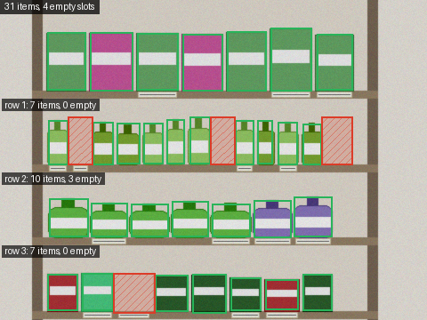
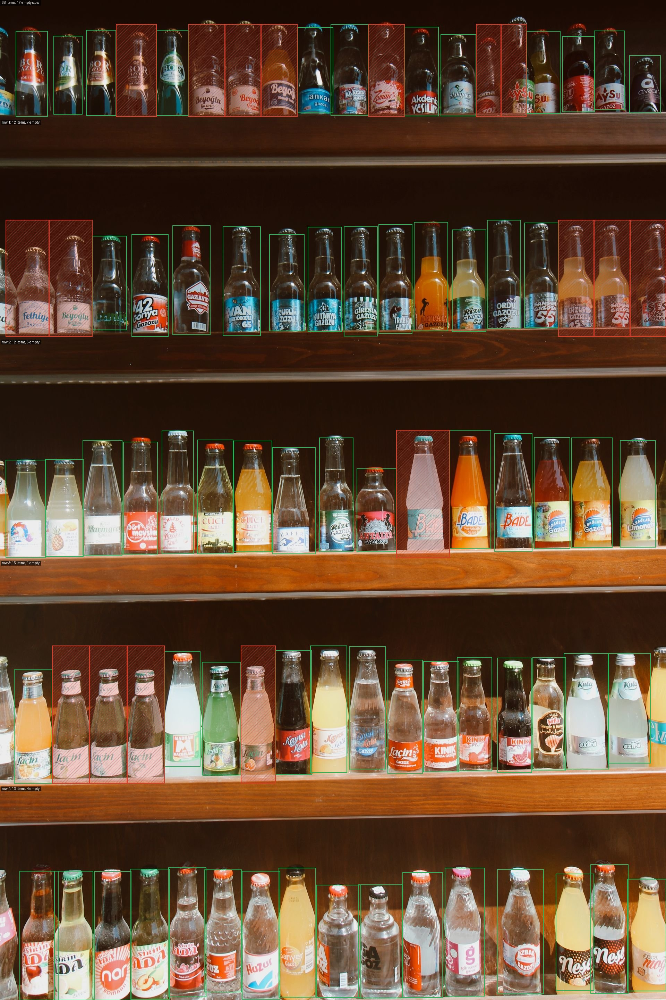
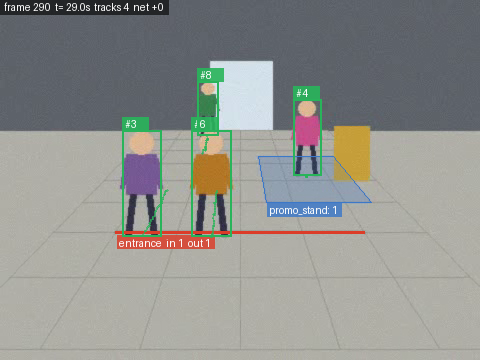
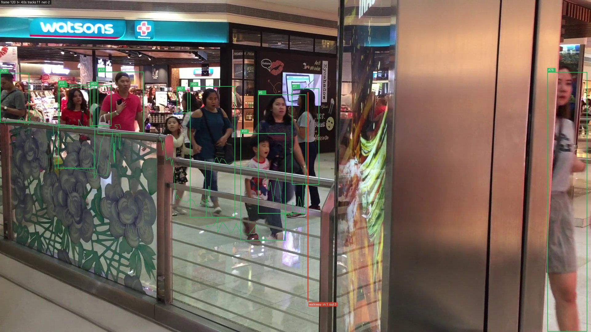

# Retail Counting Analytics

**Tech Boss · count what is on the shelf and who walks through the door.** Two modes on one CPU-only detector contract, with evidence for every number:

- **Shelf mode** (`audit_shelf.py`): a shelf photo in, `"47 items, 3 empty slots"` out, with product boxes, per-row counts and hatched empty slots drawn on the photo, a JSON report and an HTML gallery.
- **Flow mode** (`count_flow.py`): a video in, in/out counts per gate line and per time bucket out (hourly by default), zone occupancy with people per square metre, a top-down floor plan of every track, CSV, SQLite and a dashboard. Foot points are mapped through a floor homography measured from four points on site, so lines and zones are defined in metres and do not care about the camera's perspective.

Runs on-premise with no cloud account; the only model input is an ONNX file.

**Measured on synthetic fixtures, with one real-footage check.** Shelf photos and the entrance clip are drawn by `synthetic.py` so that every product, empty slot, floor position and gate crossing is known exactly and the numbers can be scored. A hand-held mall clip (Pexels, free licence) was counted with the official COCO person detector to show the pipeline on real video and what the hysteresis and ignore-zone guards do; the model card reports it with its caveats. Five real drink-shelf photos (Pexels) were audited with the official COCO bottle class and hand counted: 101 of 128 bottles found and every miss reported as a false empty slot, which is why a client's shelf needs a detector trained on its own photos. Public shelf datasets such as SKU-110K carry research-only licences and were not used.

## Quick start

Python 3.12 in a virtual environment; `requirements.txt` pins the tested versions. Offline unit tests need only the standard library.

```sh
python -m venv .venv
# Activate .venv with the command for your shell.
python -m pip install -r requirements.txt
python -m unittest discover -s tests -v
```

Reproduce the demo in four commands. Step 2 uses the sibling project; keep its weights outside Git.

```sh
python synthetic.py --dataset artifacts/dataset --shelves artifacts/shelf-test --clip artifacts/clip --count 400 --seed 5
python ../detector-training-pipeline/pipeline.py --data artifacts/dataset --output artifacts/model --epochs 6 --image-size 512 --cache-dir ../model-cache
python audit_shelf.py --input artifacts/shelf-test/images --detector onnx:artifacts/model/model.onnx --output artifacts/shelf-run --truth artifacts/shelf-test/truth.json
python count_flow.py --input artifacts/clip/clip.mp4 --config artifacts/clip/config.json --detector onnx:artifacts/model/model.onnx --output artifacts/flow-run --truth artifacts/clip/truth.json --bucket 10 --start-time 2026-11-14T09:00:00 --snapshots 90,290,550
```

Open `artifacts/shelf-run/dashboard.html` and `artifacts/flow-run/dashboard.html`.

## Real footage

```sh
python count_flow.py --input mall_rush_pexels_1338594.mp4 --config config/mall_pexels_1338594.json --detector torchvision-person-frcnn:640 --bucket 4 --output artifacts/flow-real --snapshots 40,120,200
```

`config/mall_pexels_1338594.json` is a pixel-space config with a 40 px hysteresis and an `ignore_zones` polygon over a mirrored pillar; the run is in `examples/flow-real/`.

```sh
python audit_shelf.py --input shelf-photos/ --detector torchvision-coco:bottle:product:1024 --output artifacts/shelf-real
```

`torchvision-coco:<categories>:<class>[:min_size]` keeps any COCO categories of the official Faster R-CNN under one class name, so bottle shelves can be audited without training; the run on five Pexels shelf photos with hand counts is in `examples/shelf-real/`.

## Your photos, your cameras

```sh
python audit_shelf.py --input shelf-photos/ --detector onnx:products.onnx --output out/shelf --extent 40,1240
python count_flow.py --input entrance.mp4 --config my-store.json --detector onnx:people.onnx --output out/flow --start-time 2026-11-14T08:00:00
python count_flow.py --input entrance.mp4 --config my-store.json --detector torchvision-person --output out/flow
```

**Shelf mode** needs a detector with a `product` class (an ONNX model, or `torchvision-coco:bottle:product` for bottle shelves). Rows are found by clustering box bottoms (products stand on the shelf), and inside a row a gap wider than `--min-gap-ratio` (0.8) times the row's median product width is an empty slot; a gap that would hold several products is reported as several slots. `--extent left,right` fixes the shelf edges in pixels for a fixed camera; by default the span of detected products is used, which cannot see an empty slot at a row end unless another row reaches there.

**Flow mode** needs a detector with a `person` class: an ONNX model from detector-training-pipeline, `torchvision-person` (the official COCO SSDLite320 MobileNetV3, fast) or `torchvision-person-frcnn[:size]` (the official COCO Faster R-CNN MobileNetV3 with an adjustable resize, better for small or distant people); neither needs training on real footage. The config JSON holds:

- `floor` (optional): `image_points` and `floor_points`, four or more pixel positions paired with their measured floor coordinates in metres. With `"space": "floor"`, lines and zones are in metres and zone reports include people per square metre; with `"space": "image"` everything is in pixels (`config/entrance_pixels.json`).
- `lines`: directed segments `a -> b`. A track is counted `in` when it crosses to the side where `(b - a) x (p - a)` is positive: with y up (floor metres) the left of `a -> b`, with y down (pixels) the right. Rule of thumb for a floor plan: walk from `a` to `b` with the inside of the store on your left. Swap the endpoints to flip.
- `margin`: hysteresis distance (0.3 m in the demo, 8 px in pixel space). A track's side only changes once it is at least this far from the line, and the path between the last confirmed position and the current one must cross the segment itself. A person stopping on the threshold does not count twice, and walking around the end of a gate does not count at all.
- `zones`: polygons for occupancy; peak, mean and occupied-time fraction are reported, plus density when the space is metric. Parking bays and queue areas are the same mechanism.
- `ignore_zones`: polygons where tracks are dropped before counting (mirrors, screens, a staff door).
- `--bucket` seconds for the totals table (3600 by default) and `--start-time` to stamp buckets and crossings with wall-clock time; occupancy per bucket is the running in-minus-out from the start of the recording.

## How it works

| Stage | Module | What it does |
|---|---|---|
| Detect | `detectors.py` | One `detect(image)` contract over ONNX Runtime or TorchVision; boxes clipped to the frame. |
| Track | `tracker.py` | ByteTrack-style two-stage association with constant-velocity prediction (shared with safety-video-analytics). |
| Measure | `homography.py` | Direct linear transform from point pairs, least squares when more than four, inverse for drawing; residual reported. |
| Count | `counting.py` | `LineCounter` with hysteresis and segment-extent checks; `ZoneOccupancy`; bucket totals and occupancy curve. |
| Audit | `shelf.py` | Row clustering, pitch-aware empty-slot detection, count and slot evaluation against truth. |
| Record | `store.py`, `render.py` | `totals.csv`, `counts.sqlite` (crossings, buckets, zones), `crossings.json`, annotated video and PNGs, floor-plan SVG, dashboards. |
| Score | `evaluate_flow.py`, `shelf.evaluate_shelves` | Crossings matched by line, direction and frame tolerance; count MAE, exact-count rate, slot precision/recall. |

Geometry, homography, counting, shelf logic, synthetic truth and the stores are pure Python with unit tests: perspective homography round trips, hysteresis against a person wobbling on the threshold, walking past the end of a gate, a one-step diagonal crossing, two lines and two people at once, counting in floor space from pixel paths, bucketed totals, CSV and SQLite contents with timestamps, row grouping, pitch-based slot counting, truth consistency of the scripted clip. OpenCV is used only for video I/O.

## Evidence

`examples/` holds the outputs of the actual local run described in `DATA_SOURCES.md`: the shelf dashboard and report over 40 held-out shelves with `evaluation.json`, the flow dashboard with `totals.csv`, `crossings.json`, `evaluation.json`, `run.json`, snapshots and the annotated clip, and the detector's training log, evaluation and export parity under `examples/model/`. [MODEL_CARD.md](MODEL_CARD.md) states what was measured and what was not. The same audit with a detector trained at the default 320-px input is kept in `examples/shelf-320px/evaluation.json`: products under about 35 px wide were missed and reported as empty slots (count MAE 2.0, slot precision 0.62 against 0.08 and 0.99 at 512 px), so `--image-size 512` is part of the recipe, not an optimisation.









## Limitations

- Drawn products do not overlap, lean, face sideways or reflect light; drawn walkers do not occlude like bodies or cast shadows. Thresholds (`min_gap_ratio`, `margin`, tracker settings) must be re-tuned on the client's own photos and footage.
- Shelf mode counts product instances, not SKUs: it does not say which product is missing, only where a slot is empty. Facings of a product stacked in depth are one box.
- The floor homography assumes a planar floor and a fixed camera; a bumped camera needs re-calibration (four points, a tape measure). Foot points are hidden when a person is cut off at the bottom of the frame, so lines should sit well inside the view.
- Occupancy is in-minus-out from the start of the recording; it drifts with every missed or double count and should be reset at opening time or anchored to a periodic manual count.
- No face or identity recognition is performed and none is needed; tracks are numbered per run.
- The Dockerfile and compose file target CPU on-premise deployment but were not built here because Docker was not installed on the preparation machine.
- The annotated clip is mp4v-encoded (the only encoder available locally); most browsers need H.264, so use a desktop player or re-encode.
